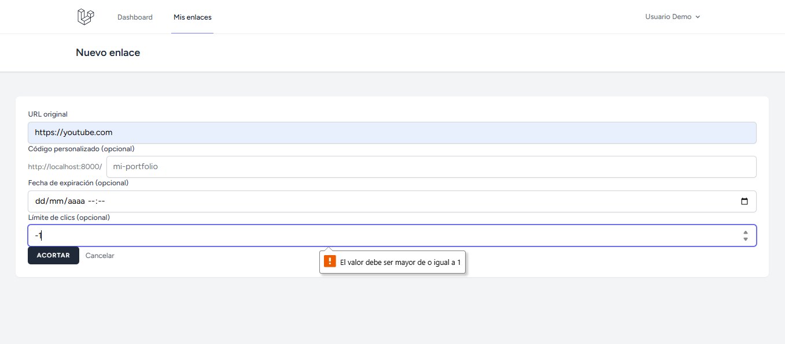
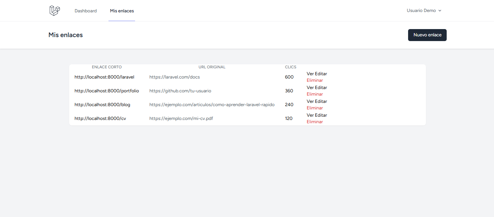
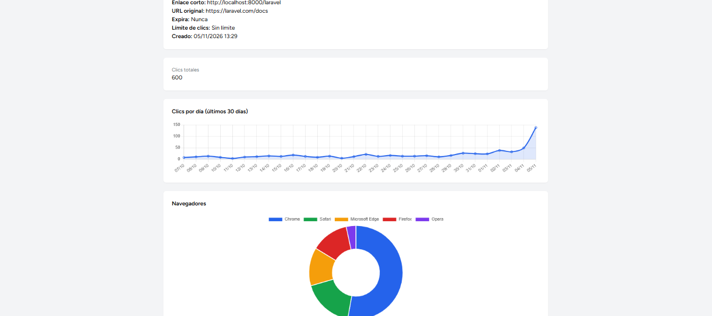

# URL Shortener

Acortador de enlaces con panel de estadísticas, hecho con Laravel y MySQL.
Cada enlace registra sus clics y muestra de dónde vienen y con qué dispositivo.

## Capturas

### Nuevo enlace


### Mis enlaces


### Panel de estadísticas


## Funcionalidades

- Registro e inicio de sesión (Laravel Breeze)
- CRUD de enlaces, cada usuario ve solo los suyos (Policies)
- Códigos cortos únicos aleatorios o personalizados, con palabras reservadas bloqueadas
- Redirección 302 con registro de cada clic
- Detección de navegador, sistema operativo y dispositivo (matomo/device-detector)
- Estadísticas: clics por día, navegadores, sistemas operativos, dispositivos y orígenes (Chart.js)
- Expiración por fecha y límite de clics (responde 410)
- Rate limiting en la redirección y en la creación de enlaces
- Tests automatizados (PHPUnit)

## Tecnologías

PHP 8.x · Laravel 13 · MySQL · Blade · Tailwind CSS · Chart.js

## Instalación

```bash
git clone https://github.com/mhermida24/url-shortener.git
cd url-shortener
composer install
npm install && npm run build
cp .env.example .env
php artisan key:generate
```

Creá una base de datos MySQL, configurá `DB_*` en el `.env` y corré:

```bash
php artisan migrate --seed
php artisan serve
```

El seeder crea el usuario demo y cientos de clics de ejemplo.

## Tests

Creá la base `url_shortener_test` y corré:

```bash
php artisan test
```

## Decisiones técnicas

- **302 y no 301:** el navegador no cachea la redirección, así cada visita pasa por el servidor y se cuenta.
- **Consultas agregadas en MySQL** (`groupBy`) en vez de contar en PHP.
- **Servicios** (`ClickRecorder`, `LinkStats`) para mantener los controladores simples.
- **Índice único en `code`** como defensa final contra duplicados, además de la validación.

## Mejoras posibles

- Registrar los clics en una cola para una redirección más rápida
- Guardar solo el dominio del referer
- Códigos QR y enlaces con contraseña